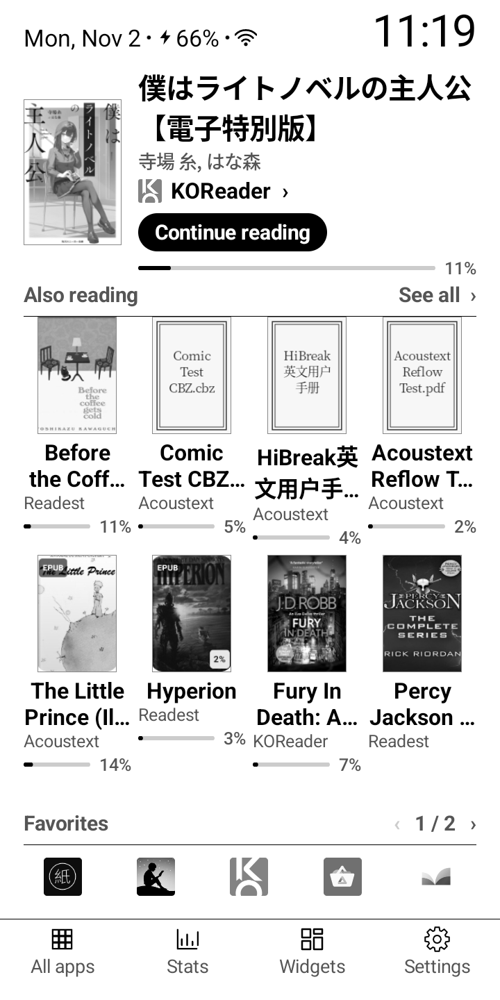
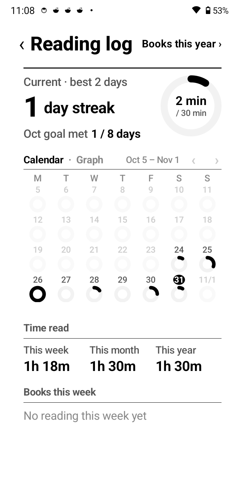
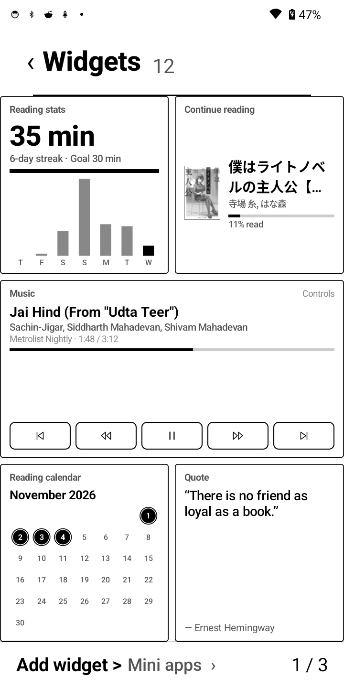
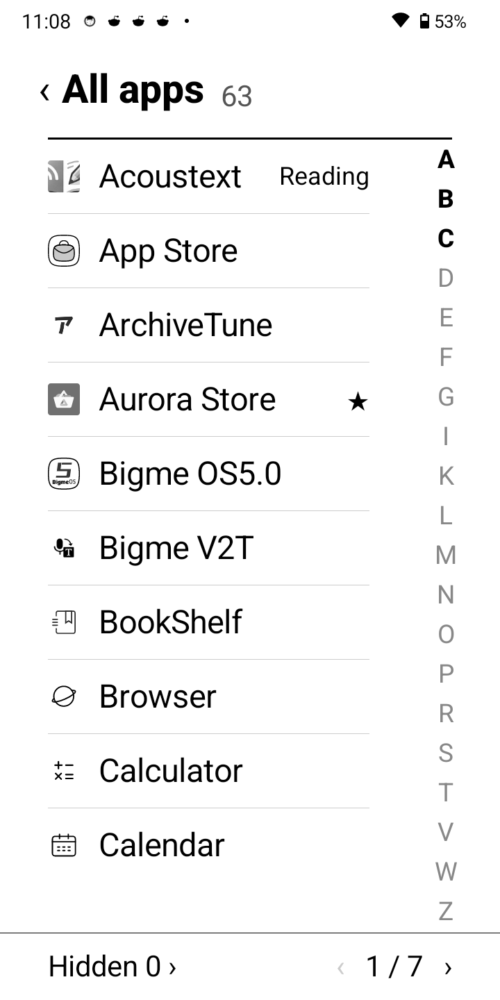
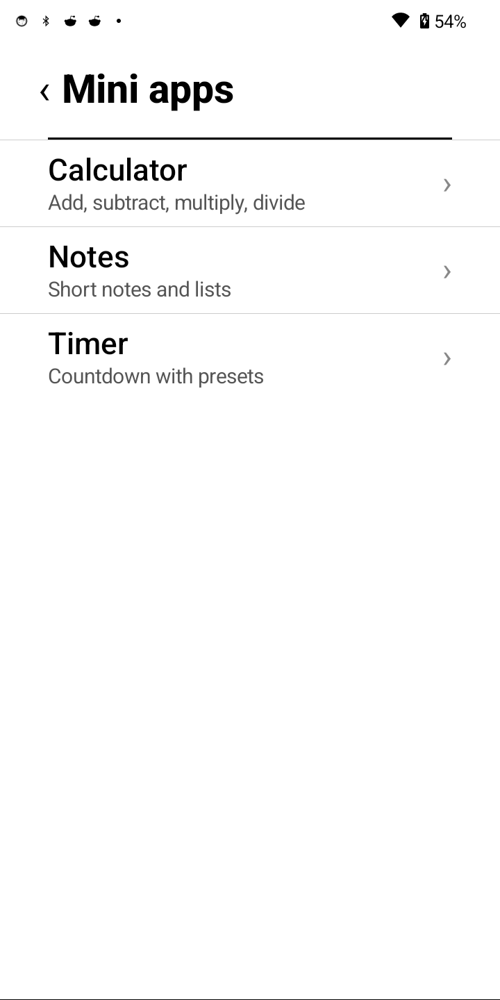
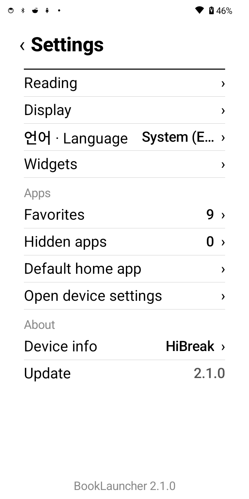
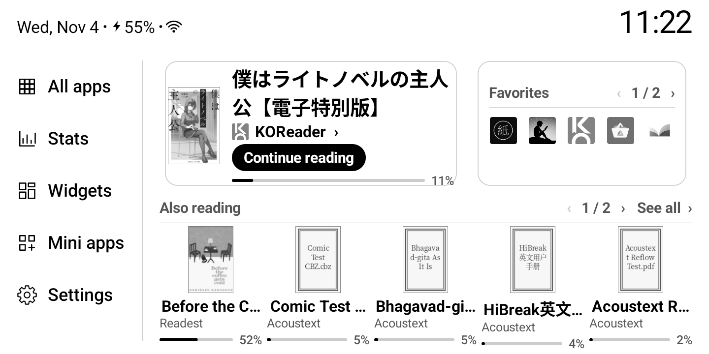

# BookLauncher — 안드로이드 이북리더기 런처

[](LICENSE)

**이북리더기를 위한 전자잉크 런처.** 지금 읽는 책이 홈에 있고, 서가는 표지 격자로 보이며, 읽은 시간·통계·위젯·앱이 한 번의 누르기로 이어진다.

[Pebble Desk](https://github.com/hissinger/pebble-desk)를 포크해 홈을 더 낮고 책 중심으로 바꿨습니다. 지금 읽는 책에는 `이어 읽기` 단추와 진행률, `함께 읽는 책`은 책마다 앱·진행률이 붙은 책장 격자, 자주 쓰는 앱은 한 줄, 아래에는 **모든 앱 · 통계 · 위젯 · 미니 앱 · 설정** 아이콘 줄(가로에서는 왼쪽 세로 줄)이 있습니다.

<p align="center"></p>

## 2.1.0에 들어간 것

- **홈의 지금 읽는 책** — 표지·제목·저자·읽는 앱과 `이어 읽기` 단추, 진행률 막대. 누구를 눌러도 그 책의 앱이 열립니다.
- **함께 읽는 책 표지 격자** — 나머지 책을 책장처럼 격자로(좁은 화면 4칸, 페블 6칸, 가로 5칸 × 2줄), 표지 아래에 제목·읽는 앱·진행률. 책이 늘어도 표지 크기는 그대로이고 쪽만 늘어납니다. `모두 보기`는 책 목록을 엽니다.
- **자주 쓰는 앱 한 줄** — 한 쪽에 5개. 직접 정한 순서, 목록·격자. 길게 눌러 이름·아이콘·빼기를 바꿉니다.
- **하단 아이콘 줄** — 모든 앱 · 통계 · 위젯 · 미니 앱 · 설정. 기기 아래 테두리와 조금 띄웠습니다. 가로에서는 왼쪽 세로 줄이 되어 책장이 화면 폭을 다 씁니다.
- **Licorice식 데스크톱 위젯** — 시계·날짜, 읽기 통계, 이어 읽기, 음악, 읽기 달력, 오늘의 문장, 기기 상태, 날씨, 헤드라인, 시세, 최근 책, 올해 읽기. `위젯 추가`에서 넣고 빼고 순서를 바꿉니다. 안드로이드 위젯은 그 뒤 쪽에 그대로 붙습니다.
- **오디오북·TTS에서도 되는 음악 카드** — 실제 제목·앱·재생 위치를 보여 주고, 미디어 키를 눈감고 보내는 대신 지금 재생 중인 미디어 세션을 직접 조절합니다. 알림 접근을 허용하면 소리 앱이 여럿 떠 있어도 확실하고, 허용하지 않으면 미디어 키로 동작합니다.
- **미니 앱** — 계산기, 메모, 타이머를 앱 안에서 오프라인으로 씁니다.
- **독서 통계** — 오늘 링, 연속일, 4주 달력·그래프, 하루 목표, 주·월·해 합계.
- **전자잉크에 맞춤** — 애니메이션 없음, 스크롤 대신 쪽, 기본 흑백, 컬러 전자잉크에서는 색.

## 화면

| 홈 | 독서 기록 | 위젯 |
|---|---|---|
|  |  |  |
| **모든 앱** | **미니 앱** | **설정** |
|  |  |  |

<p align="center"></p>

모든 화면은 HiBreak에서 찍었습니다.

## 기능

- **읽는 책 자동 추가** — [지원하는 앱](#지원하는-앱)에서 책을 펴면 표지와 함께 홈에 들어옵니다. 다른 앱의 책은 제목·저자만 적어 직접 넣고(인터넷 없이), 표지는 나중에 찾아 붙입니다.
- **책마다 읽은 시간** — 읽는 화면이 떠 있던 시간만 셉니다. 사용 기록 액세스를 한 번 허용해야 합니다.
- **완독** — 반 개 단위 별점과 짧은 감상. 다시 읽으면 회차마다 기록이 따로 남습니다.
- **올해 읽은 책** — 읽었거나 완독한 책을 목록·표지 격자로, 해를 골라서.
- **모든 앱** — 쪽으로 넘기고 색인 글자로 건너뜁니다. 안 쓰는 앱은 숨깁니다.
- **아이콘 팩** — Arcticons 같은 안드로이드 아이콘 팩, 앱마다 아이콘 바꾸기.
- **화면** — 글자 70~150%, 줄 간격 80~150%, 컬러 테마, 가로·바형 화면.
- **미니 앱** — 런처를 벗어나지 않고 계산기·메모·타이머를 씁니다.
- **기기 안에만** — 독서 기록은 밖으로 보내지 않습니다. 날씨·헤드라인·시세 위젯만 인터넷을 씁니다(Open-Meteo, Hacker News, Yahoo Finance, 계정 없음).

## 지원하는 앱

앱마다 가져오는 것(표지·제목·저자·진행률·반납일)은 설정 › 독서 › `자동 추가 안내`와 [docs/READER_APPS.md](docs/READER_APPS.md)에 있습니다.

<table>
<tr><td align="center" width="96"><br><sub>Kindle</sub></td><td align="center" width="96"><br><sub>Kobo</sub></td><td align="center" width="96"><br><sub>Libby</sub></td><td align="center" width="96"><br><sub>KOReader</sub></td><td align="center" width="96"><br><sub>Readest</sub></td><td align="center" width="96"><br><sub>BookFusion</sub></td><td align="center" width="96"><br><sub>Google Play 북</sub></td></tr>
<tr><td align="center" width="96"><br><sub>Mihon</sub></td><td align="center" width="96"><br><sub>Kahon</sub></td><td align="center" width="96"><br><sub>문리더</sub></td><td align="center" width="96"><br><sub>이지뷰어</sub></td><td align="center" width="96"><br><sub>채리뷰어</sub></td><td align="center" width="96"><br><sub>우주</sub></td><td align="center" width="96"><br><sub>교보도서관</sub></td></tr>
<tr><td align="center" width="96"><br><sub>교보eBook</sub></td><td align="center" width="96"><br><sub>밀리의서재</sub></td><td align="center" width="96"><br><sub>알라딘</sub></td><td align="center" width="96"><br><sub>북커스</sub></td><td align="center" width="96"><br><sub>리디</sub></td><td align="center" width="96"><br><sub>YES24 도서관</sub></td><td align="center" width="96"><br><sub>my YES</sub></td></tr>
<tr><td align="center" width="96"><br><sub>YES24 eBook</sub></td><td align="center" width="96"><br><sub>Futon</sub></td><td align="center" width="96"><br><sub>Kotatsu</sub></td><td align="center" width="96"><br><sub>Librera</sub></td></tr>
</table>

네오리더(BOOX), iReader(기기 내장판), AcousText도 지원합니다. AcousText는 위젯 화면의 음악 카드로 재생을 조절할 수 있습니다. 미디어 세션을 열지 않는 TTS 앱은 설정 › 위젯에서 알림 접근을 허용하세요.

## 설치

1. [Releases](https://github.com/abhifx/Booklauncher/releases)에서 `BookLauncher-2.1.0-release.apk`를 받아 기기의 파일 관리자에서 엽니다.
2. 설정 › 앱 관리 › `기본 홈 앱`에서 BookLauncher를 고릅니다.
3. 처음 실행하면 `시작하기`에서 **읽는 책 자동 추가**(접근성)와 **오늘 읽은 시간**(사용 기록 액세스)을 켭니다. 안드로이드 13+에서 파일로 설치한 앱은 앱 정보의 **제한된 설정 허용**이 필요할 수 있습니다.

문제가 생기면 [docs/TROUBLESHOOTING.md](docs/TROUBLESHOOTING.md)를 보거나 설정 › `기기 정보`를 사진으로 보내 주세요.

### HiBreak

BookLauncher는 크레마 페블과 같은 572dp 화면을 기준으로 합니다. HiBreak는 더 높은 밀도를 보고하므로 같은 홈을 작은 화면용으로 그립니다. 기기 앱 최적화에서 BookLauncher DPI를 **201**로 맞추면 원래 크기의 설계 화면으로 보입니다.

## 권한

| 권한 | 쓰는 곳 |
|---|---|
| 접근성 서비스(선택) | 읽는 책 자동 추가. 지원하는 이북 앱만 보고, 책 정보(제목·저자·진행률·반납일·표지)만 읽으며 본문은 보지 않습니다 |
| 사용 기록 액세스(선택) | 읽은 시간과 통계 |
| 모든 파일 액세스(선택) | `책 파일 읽기`: KOReader 기록, 책 파일 표지, Readest 데이터. 읽기만 |
| 인터넷 | 표지 찾기, 업데이트 확인, 만화 표지 압축 해제 도구(libarchive) 받기 |
| 앱 위젯 바인딩 | 위젯 화면에 안드로이드 위젯 표시 |

## 빌드

Android Studio의 JDK로 빌드합니다(minSdk 28, targetSdk 34, Java 17).

```bash
export JAVA_HOME="/Applications/Android Studio.app/Contents/jbr/Contents/Home"
./gradlew assembleRelease
adb install -r app/build/outputs/apk/release/BookLauncher-1.5.0-release.apk
```

윈도우에서는 `gradlew.bat`을 씁니다. 이 포크의 릴리스는 기본으로 디버그 키로 서명합니다. 널리 배포하기 전에 릴리스 서명 설정으로 바꾸세요.

설계와 동작 기준은 [DESIGN.md](DESIGN.md), 기기별 조사는 [docs/DEVICES.md](docs/DEVICES.md)에 있습니다.

## 라이선스

BookLauncher는 Pebble Desk의 포크이며 원래 라이선스와 `Required Notice`를 그대로 따릅니다. 이 포크에서 바뀐 것: BookLauncher 이름·패키지, `이어 읽기`·진행률이 있는 지금 읽는 책, 책마다 앱·진행률이 붙은 `함께 읽는 책` 격자, 자주 쓰는 앱 한 줄, 하단 아이콘 줄(가로는 왼쪽 세로 줄), 한 줄 상단, 위젯 화면.

[PolyForm Noncommercial 1.0.0](LICENSE). 개인 용도(취미·공부·연구)와 비영리 단체(학교·공공기관·자선 단체 등)는 자유롭게 쓰고, 고치고, 나눌 수 있습니다. 나눌 때는 이 라이선스와 `Required Notice` 줄을 함께 전합니다. 원본 프로젝트와 그 고지는 [NOTICE](NOTICE)에도 있습니다. GitHub의 자동 라이선스 감지는 PolyForm을 `Other`로 보지만, 적용되는 라이선스는 위와 같습니다.

상업적 이용(판매, 유료 제품·서비스에 넣기, 회사의 영리 업무에 쓰기 등)은 허용하지 않습니다. 필요하면 [GitHub 이슈](https://github.com/abhifx/Booklauncher/issues)로 문의합니다.

화면 그림에 보이는 책 표지·다른 앱 아이콘은 위 라이선스가 아니며 각 권리자의 것입니다.

완독 도장 그림(`app/src/main/res/drawable-nodpi/stamp_completed.png`)은 위 라이선스가 아닙니다. Pixabay의 [TheDigitalArtist 'Approved Stamp'](https://pixabay.com/illustrations/approved-stamp-approval-business-5254258/)([Pixabay Content License](https://pixabay.com/service/license-summary/))를 고친 것입니다(가운데 글자를 `COMPLETED`로, 흑백, `tools/stamp_completed.py`).

만화 표지 압축 해제용 libarchive의 Java 부분(`app/src/main/java/me/zhanghai/android/libarchive/`)은 [libarchive-android](https://github.com/zhanghai/libarchive-android)(Apache-2.0)를 가져와 네이티브 라이브러리를 부르는 한 줄만 고친 것입니다. 네이티브 라이브러리 `libarchive-jni.so`는 앱에 넣지 않고 사용자가 원래 Pebble Desk 릴리스 [`libarchive-1.1.7`](https://github.com/hissinger/pebble-desk/releases/tag/libarchive-1.1.7)에서 받습니다. libarchive·bzip2·xz·lz4·zstd·Mbed TLS·zlib 라이선스는 그 릴리스의 `NOTICE.txt`에 있고, `tools/libarchive/make-assets.sh`로 만듭니다.

시작하기 화면의 예시 책 표지(`app/src/main/res/drawable-nodpi/sample_cover.jpg`)는 윤동주 『하늘과 바람과 별과 시』(정음사, 1948) 초판 표지를 흑백으로 줄인 것입니다([퍼블릭 도메인 파일](https://commons.wikimedia.org/wiki/File:%EC%9C%A4%EB%8F%99%EC%A3%BC_%ED%95%98%EB%8A%98%EA%B3%BC_%EB%B0%94%EB%9E%8C%EA%B3%BC_%EB%B3%84%EA%B3%BC_%EC%8B%9C_(%EC%B4%88%ED%8C%90%EB%B3%B8,_1948).pdf), 국립한글박물관 아카이브 스캔, `tools/sample_cover.py`).
