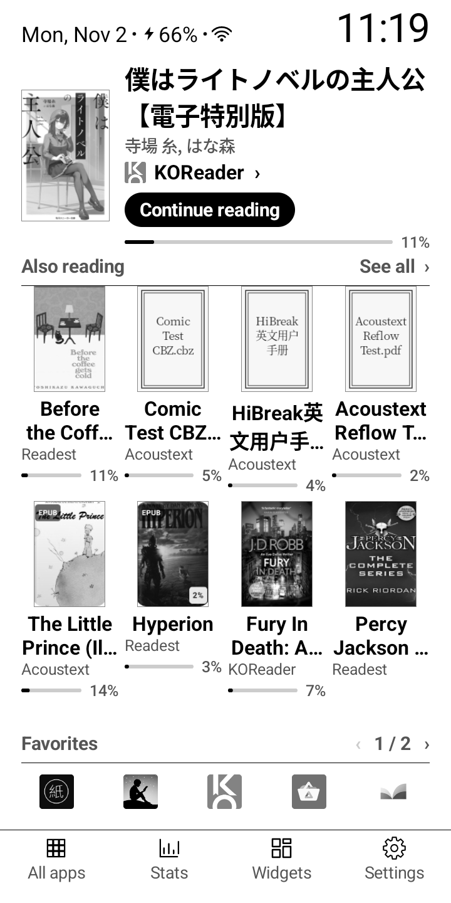
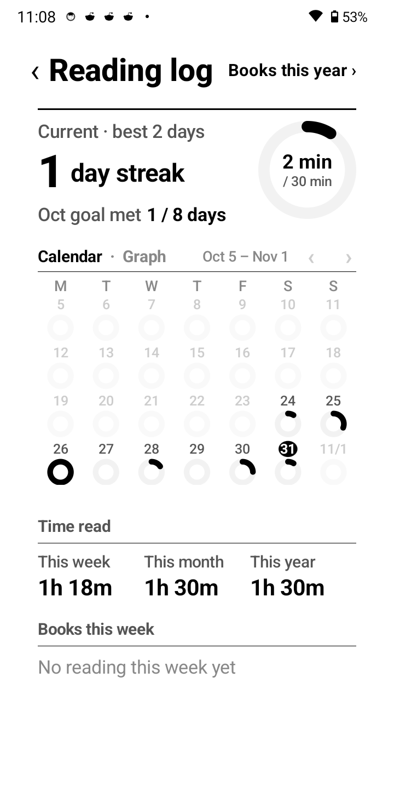
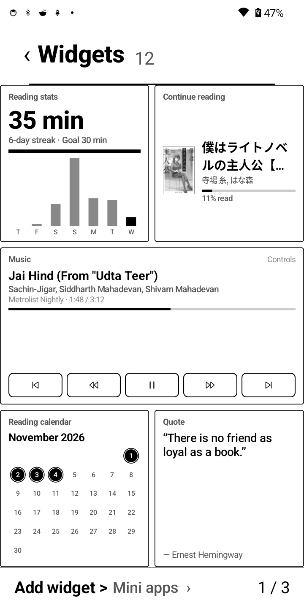
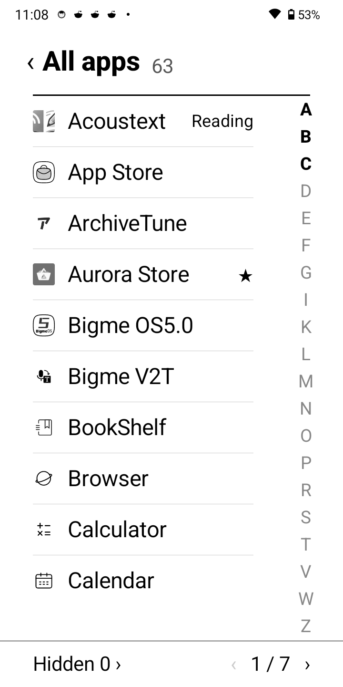
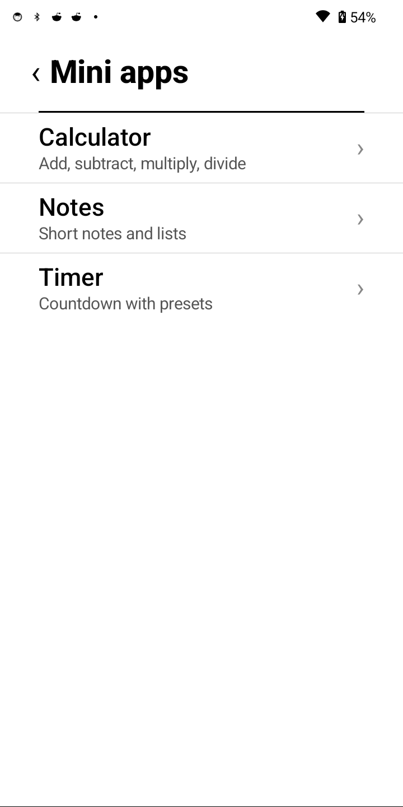
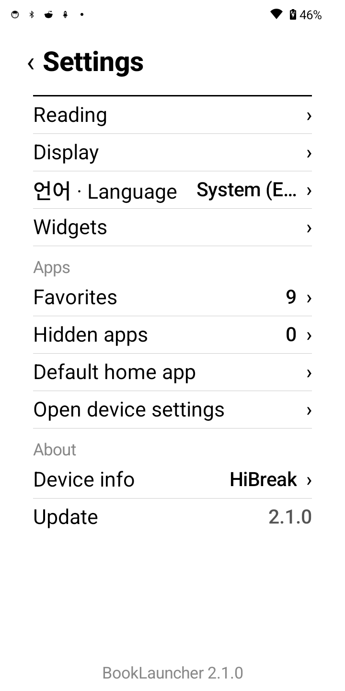
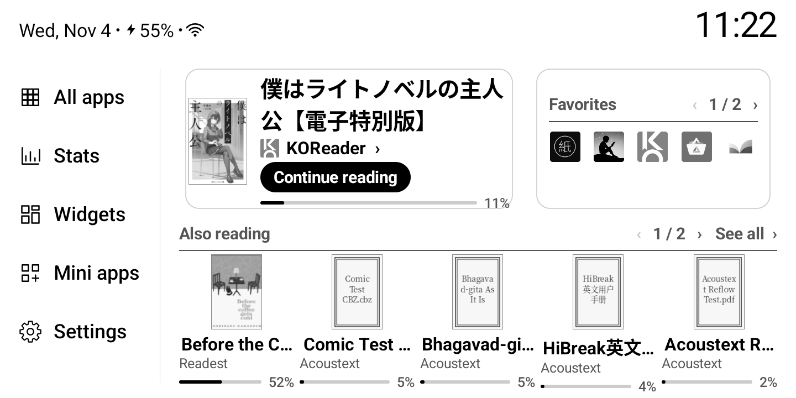

# BookLauncher

[](LICENSE)

**An E Ink launcher for Android e-readers.** The book you're reading stays on Home, your shelf is a cover grid, and reading time, stats, widgets and apps are one tap away.

BookLauncher is a fork of [Pebble Desk](https://github.com/hissinger/pebble-desk), rebuilt around a lower, more visual home screen: the current book with a `Continue reading` button and progress, a bookshelf-style `Also reading` grid with each book's app and progress, one row of favorites, and **All apps · Stats · Widgets · Mini apps · Settings** at the bottom (or as a left sidebar in landscape).

<p align="center"></p>

## What's in 2.1.0

- **The current book, on Home** — cover, title, author, reading app, a `Continue reading` button and a progress bar. Tap anywhere to open the book.
- **Also reading as a cover grid** — the other books in a bookshelf-style grid (4 columns on narrow screens, 6 on the Pebble, 5 in landscape), with title, reading app and progress under each cover. Covers keep their size as you add books; the shelf pages instead. `See all` opens the full book list.
- **One row of favorites** — 5 apps per page, in your own order. List or grid view. Long-press to rename, change the icon or remove.
- **Bottom bar** — All apps, reading Stats, Widgets, Mini apps and Settings, with a little breathing room above the device edge. In landscape it becomes a left sidebar so the shelf can use the full width.
- **Licorice-style desktop widgets** — clock and date, reading stats, continue reading, music, reading calendar, quote of the day, device status, weather, headlines, markets, recent books and the reading year. Add, remove and reorder cards from `Add widget`; Android widgets still get their own pages after them.
- **A music card that works with audiobooks and TTS** — shows the real title, app and position, and controls the active media session directly instead of firing blind media keys. Notification access makes it reliable when several audio apps are alive; without it the card falls back to media keys.
- **Mini apps** — a calculator, a notes pad and a countdown timer, built in and offline.
- **Reading stats** — today's ring, streak, four-week calendar or graph, daily goal, and weekly/monthly/yearly totals.
- **Made for E Ink** — no animation, pages instead of scrolling, monochrome first, optional color on color E Ink.

## Screenshots

| Home | Reading log | Widgets |
|---|---|---|
|  |  |  |
| **All apps** | **Mini apps** | **Settings** |
|  |  |  |

<p align="center"></p>

All screenshots were taken on a HiBreak.

## Features

- **Auto-add books** — open a book in a [supported app](#supported-apps) and it appears on Home with its cover. Books from unsupported apps can be added by hand with cover search.
- **Reading time for every book** — only the time the reading screen is actually up is counted. Usage access is needed once.
- **Finish a book** — half-star rating and a short note. Read it again and every round keeps its own record.
- **Books this year** — every book you read or finished, as a list or cover grid, for any year.
- **All apps** — paged, with a letter index. Hide the apps you never use.
- **Icon packs** — Arcticons and other Android icon packs, with per-app overrides.
- **Display** — text size 70–150%, line spacing 80–150%, optional color theme, landscape and tall screens.
- **Mini apps** — calculator, notes and a timer, without leaving the launcher.
- **Your data stays on the device** — the reading log is never sent anywhere. Weather, headlines and markets use the network (Open-Meteo, Hacker News, Yahoo Finance; no account).

## Supported apps

What each app provides (cover, title, author, progress, due date) is shown in Settings › Reading › `How auto-add works` and in [docs/READER_APPS.md](docs/READER_APPS.md) (Korean).

<table>
<tr><td align="center" width="96"><br><sub>Kindle</sub></td><td align="center" width="96"><br><sub>Kobo</sub></td><td align="center" width="96"><br><sub>Libby</sub></td><td align="center" width="96"><br><sub>KOReader</sub></td><td align="center" width="96"><br><sub>Readest</sub></td><td align="center" width="96"><br><sub>BookFusion</sub></td><td align="center" width="96"><br><sub>Google Play Books</sub></td></tr>
<tr><td align="center" width="96"><br><sub>Mihon</sub></td><td align="center" width="96"><br><sub>Kahon</sub></td><td align="center" width="96"><br><sub>Moon+ Reader</sub></td><td align="center" width="96"><br><sub>EzViewer</sub></td><td align="center" width="96"><br><sub>CherieViewer</sub></td><td align="center" width="96"><br><sub>Woojoo</sub></td><td align="center" width="96"><br><sub>Kyobo Library</sub></td></tr>
<tr><td align="center" width="96"><br><sub>Kyobo eBook</sub></td><td align="center" width="96"><br><sub>millie</sub></td><td align="center" width="96"><br><sub>Aladin</sub></td><td align="center" width="96"><br><sub>Bookers</sub></td><td align="center" width="96"><br><sub>RIDI</sub></td><td align="center" width="96"><br><sub>YES24 Library</sub></td><td align="center" width="96"><br><sub>my YES</sub></td></tr>
<tr><td align="center" width="96"><br><sub>YES24 eBook</sub></td><td align="center" width="96"><br><sub>Futon</sub></td><td align="center" width="96"><br><sub>Kotatsu</sub></td><td align="center" width="96"><br><sub>Librera</sub></td></tr>
</table>

NeoReader (BOOX), iReader (built-in) and AcousText are supported too. AcousText books can be controlled from the music card on the Widgets screen; allow notification access in Settings › Widgets for TTS apps that do not expose a media session.

## Install

1. Download `BookLauncher-2.1.0-release.apk` from [Releases](https://github.com/abhifx/Booklauncher/releases) and open it in a file manager on the device.
2. Choose BookLauncher in Settings › Apps › `Default home app`.
3. On first run, `Getting started` turns on the two core features: **Auto-add books** (Android Accessibility) and **Reading time** (Usage access). On Android 13+, an app installed from a file may need **Allow restricted settings** in its app info first.

If something goes wrong, see [docs/TROUBLESHOOTING.md](docs/TROUBLESHOOTING.md) (Korean), or send a photo of Settings › `Device info`.

### HiBreak note

BookLauncher scales itself to the same 572dp layout used on the Crema Pebble. HiBreak reports a higher density, so it uses a compact variant with the same home layout. If you prefer the full-size layout, set BookLauncher's app DPI to **201** in the device's app optimization settings (if available). The update check points at this repository's releases.

## Permissions

| Permission | Used for |
|---|---|
| Accessibility service (optional) | Auto-add books. Only supported e-book apps are watched, and only book info (title, author, progress, due date, cover), never the book's text |
| Usage access (optional) | Reading time and the Stats screen |
| All files access (optional) | `Read book files`: KOReader's records, covers from book files, Readest data. Read only |
| Internet | Cover search, update check, and downloading the comic cover unpacking tool (libarchive) |
| Bind app widget | Show Android widgets on the Widgets screen |

## Build

Build with Android Studio's JDK (minSdk 28, targetSdk 34, Java 17).

```bash
export JAVA_HOME="/Applications/Android Studio.app/Contents/jbr/Contents/Home"
./gradlew assembleRelease
adb install -r app/build/outputs/apk/release/BookLauncher-1.5.0-release.apk
```

On Windows use `gradlew.bat`. Release builds use the debug key by default for this fork; replace it with your own release signing config before distributing widely.

Design and behavior are specified in [DESIGN.md](DESIGN.md); device notes are in [docs/DEVICES.md](docs/DEVICES.md) (both Korean).

## License

BookLauncher is a fork of Pebble Desk and keeps its license and `Required Notice`. Changes in this fork: the BookLauncher name and package, the current book with `Continue reading` and progress, the `Also reading` shelf with per-book app and progress, the one-row Favorites section, the bottom icon bar / landscape sidebar, the compact top bar, and the Widgets screen.

[PolyForm Noncommercial 1.0.0](LICENSE). Individuals (hobby, study, research) and noncommercial organizations (schools, public institutions, charities, etc.) may use, modify and share it freely. When sharing, pass on this license and the `Required Notice` line. The original project and its notice are also kept in [NOTICE](NOTICE). GitHub's automatic license detector labels PolyForm as `Other`; the license above is the one that applies.

Commercial use (selling it, including it in a paid product or service, using it for a company's for-profit work, etc.) is not allowed. If you need it, ask through [GitHub issues](https://github.com/abhifx/Booklauncher/issues).

The screenshots show book covers and other apps' icons. These are not under the license above and belong to their owners.

The completed stamp (`app/src/main/res/drawable-nodpi/stamp_completed.png`) is not under the license above. It is a modified version of [TheDigitalArtist's 'Approved Stamp'](https://pixabay.com/illustrations/approved-stamp-approval-business-5254258/) on Pixabay ([Pixabay Content License](https://pixabay.com/service/license-summary/)) (center text changed to `COMPLETED`, black and white, `tools/stamp_completed.py`).

The Java part of libarchive for unpacking comic covers (`app/src/main/java/me/zhanghai/android/libarchive/`) is taken from [libarchive-android](https://github.com/zhanghai/libarchive-android) (Apache-2.0) with one line changed where it loads the native library. The native library `libarchive-jni.so` is not bundled; users download it from the upstream Pebble Desk release [`libarchive-1.1.7`](https://github.com/hissinger/pebble-desk/releases/tag/libarchive-1.1.7). Licenses for libarchive, bzip2, xz, lz4, zstd, Mbed TLS and zlib are in that release's `NOTICE.txt`; it is built with `tools/libarchive/make-assets.sh`.

The sample book cover on the Getting started screens (`app/src/main/res/drawable-nodpi/sample_cover.jpg`) is the first-edition cover of Yun Dong-ju's *Sky, Wind, Stars and Poems* (Jeongeumsa, 1948), a black-and-white reduction of the [public domain file](https://commons.wikimedia.org/wiki/File:%EC%9C%A4%EB%8F%99%EC%A3%BC_%ED%95%98%EB%8A%98%EA%B3%BC_%EB%B0%94%EB%9E%8C%EA%B3%BC_%EB%B3%84%EA%B3%BC_%EC%8B%9C_(%EC%B4%88%ED%8C%90%EB%B3%B8,_1948).pdf) on Wikimedia Commons, scanned by the National Hangeul Museum archive (`tools/sample_cover.py`).
